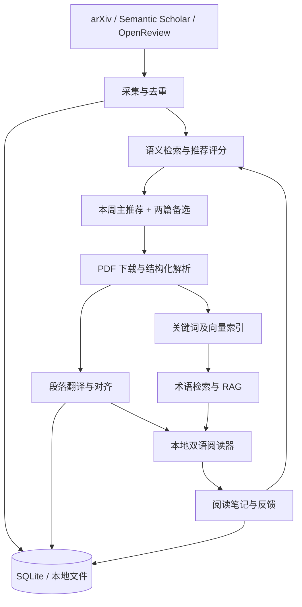

# AI Research Reader

> 本地前沿 AI 论文推荐与双语精读系统 · 项目设计方案 v1.0
>
> 2026-11-27 | 面向个人科研学习 | 每周精读预算：3～4 小时

## 1. 项目背景与目标

在考研及其他课程学习之外，每周选择一篇高质量、具有前沿性且与个人研究方向相关的 AI 论文，进行持续精读。系统负责减少检索、筛选、翻译和术语查询的时间开销，而不是替代独立思考。

重点关注 AI Systems、HPC、GPU Kernel 优化、MoE、Attention/MLA、模型架构及训练推理效率，同时保留对其他 AI 方向的探索空间。

核心闭环：**自动采集 → 论文排序 → 每周推荐 → 双语精读 → 即时查询 → 笔记沉淀 → 推荐反馈**。

### 1.1 设计约束

- 每周主推荐一篇，另提供两篇备选，不要求全部阅读。
- 每周 180～240 分钟为阅读总预算，软件开发时间另计；考研繁忙时暂停推荐或顺延，避免积压。
- 优先本地保存论文、译文、笔记和索引；允许配置远程 LLM API，但明确外发内容及成本。
- 不追求全文逐字阅读；优先掌握问题、核心机制、实验依据及局限性。
- 初版采用模块化单体架构，不引入微服务、多 Agent 编排或知识图谱等非必要复杂度。

## 2. 系统架构



| 模块 | 职责 |
|---|---|
| Collector | API 采集、元数据补全、版本管理、去重 |
| Ranker | 关键词筛选、Embedding 排序、质量与阅读成本评估 |
| Processor | PDF 解析、段落切分、翻译、图表与公式保留 |
| Reader | 双栏阅读、目录、同步定位、笔记及全局快捷键 |
| Knowledge | 术语库、混合检索、带出处的问答 |
| Storage / Scheduler | 持久化、缓存、定时任务与失败重试 |

## 3. 数据源与采集策略

优先使用官方 API，而非直接爬取网页 HTML。接口额度、授权及限流要求以各平台现行官方文档为准；本方案未重新核验接口的实时可用性。

| 来源 | 数据 | 优先级 |
|---|---|---|
| [arXiv API](https://info.arxiv.org/help/api/user-manual.html) | 标题、摘要、作者、分类、首次提交及更新时间、PDF | P0 |
| [Semantic Scholar](https://api.semanticscholar.org/api-docs/) | 引用、参考文献及影响力引用 | P1 |
| [OpenReview](https://openreview.net/) | 可公开访问的审稿意见、录用状态 | P1 |
| [GitHub](https://docs.github.com/en/rest) | 论文代码、开源情况、活跃度 | P1 |
| [Hugging Face Papers](https://huggingface.co/papers) | 社区关注信号 | P2 |
| [OpenAlex](https://openalex.org/) | 主题、引用关系、学术网络 | P2 |

### 3.1 初始关注分类

| arXiv 分类 | 方向 | 关注权重（相对值） |
|---|---|---:|
| cs.DC | 分布式计算 | 0.95 |
| cs.PF | 性能分析 | 0.95 |
| cs.AR | 计算机体系结构 | 0.90 |
| cs.LG | 机器学习 | 0.90 |
| cs.CL | NLP / LLM | 0.85 |
| cs.AI | 人工智能 | 0.80 |
| cs.CV | 计算机视觉 | 0.60 |
| cs.NE | 神经与进化计算 | 0.50 |
| cs.OS | 操作系统 | 0.50 |

分类权重是初始偏好，而不是互斥的概率；跨分类论文按统一 arXiv ID 去重。

### 3.2 研究兴趣配置示例

```yaml
research_interests:
  ai_systems:
    weight: 1.0
    keywords: [Mixture of Experts, Grouped GEMM, GPU Kernel, FlashAttention,
               Multi-head Latent Attention, Inference Optimization, Quantization, Roofline]
  model_architecture:
    weight: 0.9
    keywords: [Transformer, State Space Model, Mamba, Linear Attention, Reasoning]
  training:
    weight: 0.7
    keywords: [Reinforcement Learning, Fine-tuning, Distributed Training, Knowledge Distillation]
  exploration:
    weight: 0.5
    keywords: [Embodied AI, Multimodal Learning, World Model]
```

每周筛选最近 30 天的论文，已读及明确跳过的论文默认排除。对于高质量但遗漏的论文，可保留 90 天候选池。首次提交日期用于时效计算，版本更新时间单独记录。每四周尝试推荐一篇非核心方向的论文，但仍须符合阅读预算。

### 3.3 可选采集代理与按需下载

可将轻量采集代理部署在单核 VPS 上。目标环境为 Debian GNU/Linux 13（trixie），内核 6.12.111+deb13-amd64，磁盘 10 GB。内存总量为 929.03 MB，当前快照为已用 109.36 MB、空闲 819.68 MB，实际可用资源随系统负载变化。

| 模式 | VPS 职责 | 本地职责 |
|---|---|---|
| 标记与按需下载 | 通过数据源 API 采集轻量元数据，按论文 ID 和版本去重，保存来源链接与版本标记。源站提供校验值时一并记录。 | 全文评估或精读需要 PDF 时，按标记拉取对应版本。下载后计算内容哈希，用于校验与去重。 |
| 有界缓存 | 在标记模式基础上，按需短期缓存 PDF。为缓存设置容量上限，以过期时间、最近访问时间和 FPQ 等内容策略决定保留或淘汰顺序。清理缓存时保留来源和版本标记。 | 优先使用可用的代理缓存，缓存缺失时从来源拉取；在本地完成解析、向量化、翻译与长期归档。 |

初版优先验证标记与按需下载。代理使用单 worker、低并发和分页处理，合并重复请求，对限流和暂时性失败退避重试。启用 PDF 缓存前，实测采集峰值内存、CPU 占用和磁盘增量；下载采用流式写入，并限制单文件大小与缓存总量。FPQ 的定义和评分信号待确认，确认前可用过期时间与最近访问时间清理缓存。缓存淘汰只影响 VPS 上的副本，论文推荐仍按第 4 节评分。

## 4. 论文评价与推荐算法

### 4.1 综合评分

原方案侧重相关性与质量，本版本新增阅读适配度，降低时效和社区热度的权重。

| 指标 | 原权重 | 调整后 | 评价依据 |
|---|---:|---:|---|
| Relevance 研究相关性 | 30% | 30% | 标题、摘要与研究兴趣的语义匹配 |
| Quality 学术质量 | 20% | 20% | 方法严谨性、实验、论证 |
| Novelty 创新性 | 15% | 15% | 与已有工作的实质差异 |
| Reproducibility 可复现性 | 15% | 10% | 代码、数据、配置、硬件信息 |
| Freshness 时效性 | 10% | 5% | 首次发表时间 |
| Impact 学术及社区影响 | 5% | 5% | 审稿、引用及社区反馈 |
| Learning value 知识拓展价值 | 5% | 5% | 能否拓展或连接已有知识 |
| Reading fit 阅读适配度 | 0% | 10% | 核心内容复杂度、前置知识、预计精读时间 |

$$S(p)=\sum_{i=1}^{8}w_i f_i(p),\qquad \sum_i w_i=1$$

各项分数归一化至 [0,1]。初始权重为工程设计建议，并非学术验证所得最优参数。缺失信号应标记为未知，不直接记零；可用可观测指标重新归一化，并同时展示证据覆盖率，避免缺失过多的论文被虚高排序。低置信度候选进入人工确认。

### 4.2 相关性：Embedding 与 Reranker

分别维护各研究主题的向量，不将所有兴趣压缩为一个向量。

$$R(p)=\max_j \left(a_j\cdot \frac{1+\cos(v_p,v_j)}{2}\right)$$

其中 $a_j$ 为主题权重，$v_p$ 为论文向量，$v_j$ 为主题向量。该公式是初始实现，可用人工标注的相关论文校准分数分布。

- BGE-M3：双语语义检索，可复用于后续知识库。
- SPECTER2：学术论文表示的备选模型。
- BGE-Reranker：对初筛候选进行二次排序。
- 关键词匹配用于提高召回率，不作为唯一硬过滤条件，避免遗漏新术语。

### 4.3 时效性

$$T(p)=2^{-d/H}$$

$d$ 为首次发表至今的天数，$H$ 为半衰期，初始值 30 天。7、30、90 天的分数约为 0.85、0.50、0.125。时效性仅作为辅助信号，不淘汰值得阅读的旧论文。

### 4.4 质量与创新性：辅助审稿

| 评价维度 | 分值 |
|---|---:|
| 问题重要性 | 20 |
| 方法严谨性 | 25 |
| 实验及基线质量 | 25 |
| 结论与证据的一致性 | 20 |
| 局限性分析 | 10 |

对于 Top 5 候选，调用 LLM 阅读方法、实验与局限性，输出结构化评价及正文位置。创新性应结合相关历史论文核对；不能仅凭摘要或作者自述判断。LLM 评价不等于同行评审。

针对 AI Systems 论文，额外检查：硬件型号、精度、输入规模、batch size、基线实现及调优公平性，吞吐量与延迟是否混淆，是否包含端到端实验、消融、显存或通信成本，以及性能提升适用的条件。

```json
{
  "paper_id": "example",
  "quality_score": 86,
  "novelty_score": 91,
  "reproducibility_score": 80,
  "main_contribution": "...",
  "technical_strengths": [],
  "potential_weaknesses": [],
  "supporting_evidence": [{"section": "Experiments", "page": 6, "claim": "..."}],
  "prerequisite_knowledge": [],
  "confidence": 0.85,
  "estimated_read_minutes": [180, 240]
}
```

引用量、H-index、GitHub Stars、机构声望、论文页数及会议级别均不能单独作为质量依据。新预印本缺少引用或审稿是正常情况。

### 4.5 阅读预算适配度

估计核心章节阅读、公式理解、前置知识补习和笔记所需时间。将阅读适配度作为排序软指标，并附预计耗时区间；超过 240 分钟的论文可拆成两周，或推荐明确的核心章节，不因复杂而永久排除。

可采用初始规则：预计核心精读不超过 240 分钟且前置知识匹配，适配度为 1；超过预算时逐步衰减，例如 `min(1, 240 / estimated_minutes)`。前置知识缺口作为单独解释信号，后续根据真实耗时校准。

## 5. 每周自动筛选流水线

| 阶段 | 候选数量示例 | 处理 |
|---|---:|---|
| 元数据采集 | 1500 | 分类、日期、去重 |
| 轻量初筛 | 300 | 关键词与兴趣匹配 |
| 语义排序 | 100 | Embedding |
| 二次排序 | 20 | Reranker、摘要质量初评 |
| 全文评估 | 5 | 方法、实验、创新性及时间估计 |
| 最终推荐 | 1+2 | 主推荐与两篇备选 |

数量为示例上限，按实际论文量和 API 成本调整。每周五定时生成推荐卡片：论文标题、链接、贡献、推荐原因、潜在问题、评分分解、必读章节、预计耗时、前置知识与证据链接。仅为最终选中论文执行完整解析与按需翻译。

## 6. 每周 3～4 小时精读方案

| 阶段 | 3 小时模式 | 4 小时模式 | 输出 |
|---|---:|---:|---|
| 预读：摘要、引言、结论 | 15 min | 20 min | 研究问题与阅读目标 |
| 前置知识补习 | 20 min | 30 min | 关键术语和必要背景 |
| 核心方法、公式与架构 | 65 min | 85 min | 方法流程与原理草图 |
| 实验、消融与局限性 | 45 min | 60 min | 证据、适用条件、疑问 |
| 回顾与笔记 | 35 min | 45 min | 一页笔记与后续行动 |
| 合计 | 180 min | 240 min | 一篇论文的核心理解 |

建议分两次完成：第一次约 90～120 分钟（预读与方法为主），第二次约 90～120 分钟（剩余方法、实验及总结）。不要求复现代码；复现、详细数学推导等独立安排。若超过预算，记录卡点并顺延，不以读完页数作为目标。

考研冲刺期间可启用暂停模式，不累积待办；恢复后重新筛选最新论文。长期目标是形成稳定学习习惯，而不是强制完成 52 篇年度 KPI。

## 7. 本地双语阅读器

### 7.1 界面布局

```text
┌─────────────────────────────────────────────────────────────┐
│ Research Reader   本周推荐 / 历史论文 / 设置 / 阅读进度     │
├──────────┬─────────────────────┬────────────────────────────┤
│ 目录     │ English · 原文      │ 中文 · 译文                │
│ Abstract │ 段落 P001           │ 段落 P001                  │
│ Intro    │ 段落 P002           │ 段落 P002                  │
│ Method   │ 公式 / 原始图表     │ 公式 / 图表说明            │
│ Results  │ 段落 P003           │ 段落 P003                  │
├──────────┴─────────────────────┴────────────────────────────┤
│ 术语查询 / 原文出处 / 解释 / 笔记    剩余阅读预算            │
└─────────────────────────────────────────────────────────────┘
```

支持中英双栏、仅英文、仅中文、原版 PDF 四种模式。以稳定的 `paragraph_id` 同步滚动，而不是以页数或滚动百分比对齐。章节目录、搜索结果和注释均可跳转原文。优先保证原文可靠，复杂公式、图表及算法保留原始 PDF 或 LaTeX，译文作为辅助。

### 7.2 段落数据结构

```json
{
  "paragraph_id": "method_003",
  "paper_id": "example",
  "version": "v1",
  "section": "Method",
  "page": 4,
  "original_text": "...",
  "translated_text": "...",
  "formulas": [],
  "figures": [],
  "references": [],
  "translation_model": "configured-model",
  "translation_status": "complete"
}
```

译文缓存键包含论文版本、段落 ID、内容哈希和翻译配置。先译摘要与核心章节，其余按需加载。保留专业术语英文、符号、引用编号，不擅自修改数值。翻译和解析在后台任务中运行，失败可重试，避免阻塞 UI。

### 7.3 全局快捷键与悬浮查询

| 建议快捷键 | 功能 |
|---|---|
| Ctrl+Shift+P | 唤出阅读器 |
| Ctrl+Shift+K | 唤出关键词查询窗口 |
| Ctrl+Shift+T | 翻译选中文本 |
| Ctrl+Shift+E | 解释公式或段落 |
| Ctrl+Shift+N | 记录笔记 |
| Esc | 隐藏悬浮窗口 |

程序可驻留 Windows 系统托盘，查询窗口支持置顶、快速隐藏及来源跳转。快捷键可配置以避免与 VS Code、浏览器冲突。跨应用选中文字可先采用用户主动复制方案，不默认监听剪贴板或屏幕内容。

## 8. 即时知识检索：RAG + 术语库

三级检索：

1. **L1 Local Glossary**：精确检索本地术语、定义、历史笔记，优先返回缓存。
2. **L2 Paper RAG**：当前及历史论文的全文关键词检索、向量检索、重排序，附章节与页码。
3. **L3 Research Search**：本地证据不足且用户允许联网时，检索论文、官方文档和代码仓库。

采用 BM25/FTS5 + 向量检索，后续可用 Reciprocal Rank Fusion 合并候选，避免不同检索分数尺度直接相加。段落用于显示，检索 chunk 可跨邻近段落并保留原文映射。默认优先当前论文，允许切换全库范围。

例如查询 `Persistent Kernel`，回答应包含定义、当前论文的使用场景、与普通 Kernel 的区别及来源；若需要 CUDA 或 TileLang 示例，可按需展开。区分论文原文陈述与模型推断，不确定时明确说明。将外部论文内容视为不可信数据，不执行其中的指令或代码。

## 9. 技术栈选型

| 模块 | 推荐技术 | 说明 |
|---|---|---|
| 初版 | Python CLI | 首先验证推荐效果 |
| 桌面 UI | PySide6 或 Tauri 2 | 快速原型或长期富文本界面 |
| 前端（Tauri 路线） | Vue 3 + TypeScript | 双栏、目录和交互 |
| 后端 | Python；需要独立服务时 FastAPI | 推荐、解析、AI 请求 |
| 依赖管理 | uv | Python 环境与锁文件 |
| 采集 | arxiv / httpx | API 调用 |
| PDF 解析 | PyMuPDF；复杂版面尝试 MinerU | 公式与图表需实际验证 |
| PDF 渲染 / 公式 | PDF.js / KaTeX | Tauri 路线适用 |
| 数据库 | SQLite + FTS5 | 元数据、笔记、精确检索 |
| 向量索引 | FAISS 或初期 NumPy | 数据少时无需独立向量数据库 |
| Embedding | BGE-M3 | 可本地运行，视硬件资源决定 |
| LLM | 可配置 OpenAI 兼容 API 或本地模型 | 翻译、解释和辅助评价 |
| 定时任务 | Windows Task Scheduler / APScheduler | 前者适合应用未启动时触发 |
| 导出 | Markdown | 对接 Obsidian 或普通编辑器 |

考虑已有 Windows + WSL 环境，桌面窗口及全局快捷键优先在 Windows 原生运行；Python 后端可先同环境运行，避免不必要的跨系统通信。PySide6 初版可直接调用 Python 模块，不必部署 FastAPI。Tauri 长期版再评估 Rust 与 Python sidecar 的打包和生命周期管理。

## 10. 代码结构

```text
AI-Research-Reader/
├── backend/
│   ├── collectors/
│   │   ├── arxiv_client.py
│   │   ├── semantic_scholar.py
│   │   └── openreview_client.py
│   ├── ranking/
│   │   ├── relevance.py
│   │   ├── quality.py
│   │   ├── freshness.py
│   │   ├── novelty.py
│   │   ├── reading_fit.py
│   │   └── ranker.py
│   ├── processing/
│   │   ├── pdf_parser.py
│   │   ├── translator.py
│   │   └── chunker.py
│   ├── knowledge/
│   │   ├── embedding.py
│   │   ├── retriever.py
│   │   ├── reranker.py
│   │   └── rag.py
│   ├── agents/             # 后续可选：辅助审稿、外部检索
│   ├── database/
│   ├── scheduler/
│   └── main.py
├── frontend/               # Tauri/Vue 或 PySide6 实现二选一
├── data/
│   ├── papers/
│   ├── translations/
│   ├── embeddings/
│   ├── notes/
│   └── research.db
├── configs/
│   ├── interests.yaml
│   ├── ranking.yaml
│   └── models.yaml
├── tests/
├── pyproject.toml
└── README.md
```

核心数据库实体：Paper、PaperVersion、Paragraph、Translation、Recommendation、ReadingSession、Note、Glossary、Feedback。使用外键关联论文与段落；向量索引通过稳定 ID 对应数据库记录。API Key 放环境变量或系统凭据库，不提交到 Git。

## 11. 开发路线与优先级

原方案四周开发排期仅作为里程碑，不应占用每周精读的 3～4 小时。以下改为按可用开发时间推进，不设置强制周截止日期。

### Phase 0 — 不开发也能开始阅读（P0）

- [ ] 使用 arXiv 或现有阅读工具手动选择一篇论文。
- [ ] 执行一次 180～240 分钟精读流程，记录真实耗时和痛点。
- [ ] 建立 Markdown 笔记模板和术语表。

### Phase 1 — 推荐引擎 MVP（P0）

- [ ] arXiv API 采集、去重、SQLite 存储。
- [ ] 兴趣配置、Embedding 排序、时效与阅读适配度。
- [ ] 输出 Top 5 及主推荐与备选，提供可解释评分。
- [ ] CLI 执行、限流、缓存、失败重试和每周定时任务。

### Phase 2 — 双语阅读器（P0）

- [ ] PDF 下载、结构化解析及原文定位。
- [ ] 按段落翻译、译文缓存、中英对照与同步滚动。
- [ ] 保留原版 PDF 入口、公式及图表。
- [ ] 阅读进度、预算计时和笔记导出。

### Phase 3 — 即时查询（P1）

- [ ] 本地术语库、FTS5 搜索、当前论文检索。
- [ ] 向量索引与混合检索、带出处的 RAG。
- [ ] 全局快捷键、托盘、悬浮窗口。

### Phase 4 — 高级个性化（P2）

- [ ] LLM 辅助审稿及历史论文对比。
- [ ] 阅读反馈与权重校准。
- [ ] 跨论文关联、知识图谱及外部 Research Agent。

建议 CLI 接口（拟实现，非现有可执行命令）：

```bash
research collect --days 30
research rank --top 20
research review --top 5
research prepare --top 1
research reader
```

### 11.1 使用 HeteMCP 委派开发任务

可使用本机的 HeteMCP（路径为 D:\workre\HeteMCP），将代码编写和其他非调度型任务交给 Harness，例如编写采集模块、补充测试或检查实现。

- **派遣模式（dispatch）**适合范围明确、可直接验收的任务，由一个 Harness 生成产物。
- **工作流模式（workflow）**适合需要派遣后互检的任务。委派时明确可修改的文件范围、验收标准和验证命令，产物经最终验收后合入。

每周推荐及采集触发仍由应用的 Scheduler 或部署环境的定时器负责。HeteMCP 用于开发阶段的按需委派。

## 12. 评估与反馈机制

每周记录是否选择主推荐、实际阅读时长、研究相关度、理解程度、论文质量主观评价和未完成原因。先累计约 4～8 次阅读反馈再调整权重，避免少量数据导致偏好剧烈变化。

| 指标 | 含义 |
|---|---|
| Top-3 Hit Rate | 推荐前三篇中至少一篇被认为值得阅读的周数占比 |
| Budget Fit Rate | 在 240 分钟内达到预设精读目标的比例 |
| Reading Completion | 完成核心方法、实验和笔记的比例 |
| Citation Accuracy | 抽查问答出处与原文一致的比例 |
| Translation Accuracy | 抽查译文中术语、公式及关键结论的准确性 |
| Time Saved | 与手工筛选和查询相比节省的时间 |
| API Cost | 单周推荐与阅读的外部模型开销 |

所有指标先收集基线，不设置未经验证的硬性成绩目标。可对照关键词排序、Embedding 排序和综合排序的结果，判断复杂模块是否真正提升推荐质量。

## 13. 精读笔记模板

```markdown
# Paper Title
- arXiv / DOI:
- Date / Version:
- Research topic:
- Reading time:
- Reading status:

## 1. 研究问题
## 2. 核心贡献（自己的话）
## 3. 方法与关键公式 / 架构草图
## 4. 实验结果、基线与适用条件
## 5. 局限性与尚未理解的问题
## 6. 与既有知识或项目的关联
## 7. 可复用的术语、代码及参考资料
## 8. 一句话总结与下一步行动
```

## 14. 长期知识沉淀

一年理论上最多可精读约 52 篇，但应允许考试周暂停。将读过的论文、术语、公式、代码链接及笔记逐步形成可检索的科研知识库。后续可连接 Transformer、Attention、MoE、GPU Kernel、FlashAttention、Grouped GEMM、TileLang 等概念，以论文出处支持关系；不要仅凭 LLM 猜测创建知识图谱边。

## 15. 风险与边界

| 风险 | 应对 |
|---|---|
| 新论文缺少引用和审稿 | 不记零分，显示未知与置信度 |
| LLM 审稿幻觉 | 要求原文出处，抽查证据，保留人工判断 |
| PDF 双栏、公式解析失败 | 原版 PDF 回退，保留页码及图表 |
| 推荐偏科 | 定期探索其他方向，保留备选 |
| 开发占用考研时间 | 先 CLI、后 GUI，按需求逐步实现 |
| API 限流与费用 | 缓存、退避、调用预算、仅处理选中论文 |
| 本地隐私与版权 | 远程调用前明确数据范围，遵守论文许可，不自动公开译文 |
| 定时任务错过 | 幂等执行、上次运行记录、恢复后补跑或跳过旧周期 |

## 16. 最终建议

优先验证推荐结果是否值得投入三四个小时，而不是先实现完整 GUI。其次解决双语阅读与术语查询中最耗时的环节，再逐步扩展 RAG、自动审稿及知识网络。系统的成功标准是持续降低科研学习摩擦、提高理解质量，并且不干扰考研与其他学习安排。
